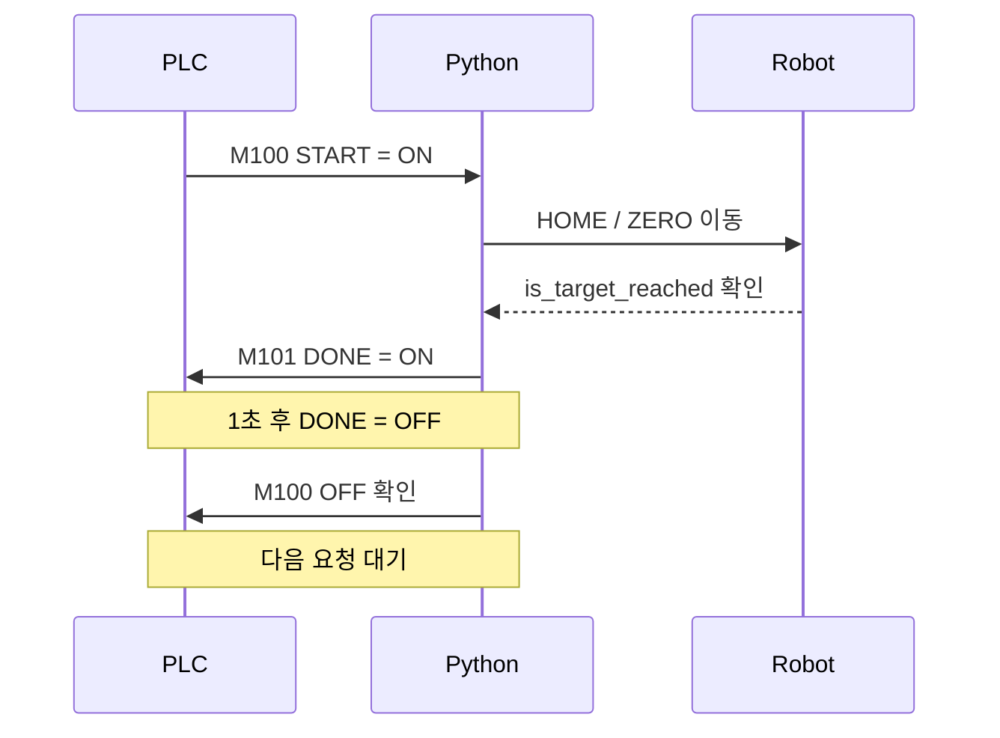

<div align="center">

# 신이서 · FA 자동화 포트폴리오
**입력부터 출력까지, 신호의 흐름을 이해하는 FA 엔지니어**

PLC 제어 · 구동 및 네트워크 · 산업용 로봇 · Python 설비 연동

[PLC 래더 자료](https://github.com/seo219/PLC_Practice/tree/main/ladderPDF) · [로봇 제어 코드](https://github.com/seo219/neuromeka_Py) · [GitHub](https://github.com/seo219)

</div>

---

## 소개

교육 과정에서 구성하고 실습한 PLC, 공압·유압, 산업용 로봇 제어 경험을 정리했습니다. 센서 입력과 동작 조건을 해석하고, 순차 제어 로직과 모션 명령을 작성하며, PLC와 Python 사이의 시작·완료 신호를 연결하는 데 집중했습니다.

이 저장소는 분야별 실습 결과와 원본 저장소를 연결하는 **FA 자동화 직무용 포트폴리오**입니다. 설명은 기존 실습 코드, 포트폴리오 자료와 팀 프로젝트 발표자료를 바탕으로 정리했으며, 상용 설비 납품 실적이나 정량 성과를 의미하지 않습니다.

## 대표 프로젝트

### AI 로봇 윷놀이 · SO-101 로봇암 제어

**담당 분야: 로봇암** · 5인 팀 · 2026년 10~11월

실제 윷놀이의 말을 집어 옮기는 로봇 모듈에 참여했습니다. 모방학습용 동작 데이터 수집과 칸별 자세 측정·말 이송 관련 작업을 담당했고, 최종 시스템은 측정 자세 기반 Python 제어에 손목 카메라 보정을 결합했습니다.

- **문제:** 말이 기준 좌표에서 조금만 벗어나도 파지에 실패했습니다.
- **팀의 개선:** 집기 직전 위치 보정, 그리퍼 상태 확인·재시도, 업힌 말 높이와 수직 상승 경로를 반영했습니다.
- **팀 시험 결과:** 실물 게임 4판에서 이동 86회 중 85회 성공. **재시도 18회가 포함된 수치**이며 최초 시도 성공률과 다릅니다.

[프로젝트 상세 · 담당 범위·문제 해결·시험 근거 보기](docs/ai-yutnori-robot-arm.md)

### 분야별 제어 실습

| 프로젝트 | 구현 내용 | 확인할 역량 | 상세 |
|---|---|---|---|
| PLC ↔ Python ↔ Robot 연동 | M100 시작 감시 → HOME/ZERO 이동 → M101 완료 반환 | 이기종 설비 연동, 완료 동기화, 재트리거 방지 | [프로젝트 보기](docs/plc-robot-handshake.md) |
| PLC 공정·구동·통신 제어 | 순차 제어, 인버터 속도 제어, 서보 티칭, CC-Link I/O | 래더 해석, 데이터 연산, 위치결정, 인터록 | [프로젝트 보기](docs/plc-control.md) |
| 로봇 반복 이송·팔레타이징 | TCP 상대 이동, 5×5 좌표 생성, 그리퍼·진공 제어 | 좌표계 이해, 반복 패턴, Pick & Place | [프로젝트 보기](docs/robot-control.md) |
| 공압·유압 회로 실습 | 밸브 배관, 실린더 왕복, 유압 모터 구동 | 회로와 실제 액추에이터 동작 연결 | [실습 보기](docs/fluid-power.md) |

## 코딩 포트폴리오

Python 자동화 코드를 **함수 구조·좌표 계산·통신·예외 처리** 관점에서 정리했습니다.

| 개발 포인트 | 대표 코드 |
|---|---|
| 계산과 장비 제어의 함수 분리 | 팔레타이징·TCP 접근점 생성 |
| 비동기 장비의 완료 확인 | motion_id와 타임아웃 기반 대기 |
| 외부 장치 통신과 상태 관리 | PLC START/DONE 핸드셰이크 |
| 코드 검토와 실행 조건 | 미설정 좌표, 주석·인자 차이, SDK 설정 |

[코딩 포트폴리오 상세 보기](docs/coding-portfolio.md)

## 설비 연동 대표 흐름



## 기술과 실습 범위

| 분야 | 사용 기술·장비 | 실습 내용 |
|---|---|---|
| PLC | GX Works, PLC Trainer, 래더 | 자기유지, 센서 조건, 단계 릴레이, 순차 제어 |
| HMI | 화면 구성 및 제어 자료 | 공정 상태·제어 화면 정리 |
| 모션 | 인버터, 서보, QD75 | 아날로그 속도 지령, JOG, 위치결정, 티칭 |
| 통신 | CC-Link, MC Protocol, pymcprotocol | 원격 I/O, 비트 읽기·쓰기, 설비 신호 연동 |
| 로봇 | Neuromeka Indy, IndyDCP3, Python | Joint/TCP 이동, MoveL/MoveC, 그리퍼·흡착, 반복 이송 |
| 공유압 | 방향제어밸브, 실린더, 유압 모터 | 회로 해석, 배관 연결, 동작 확인 |

## 먼저 살펴볼 코드

| 코드 | 핵심 확인 지점 |
|---|---|
| [pc_plc_robot.py](https://github.com/seo219/neuromeka_Py/blob/main/pc_plc_robot.py) | M100/M101, 이동 완료 대기, 시작 신호 OFF 대기 |
| [tcp_rel.py](https://github.com/seo219/neuromeka_Py/blob/main/tcp_rel.py) | TCP 좌표계를 기준으로 한 상대 이동 |
| [25repeat.py](https://github.com/seo219/neuromeka_Py/blob/main/25repeat.py) | 25개 위치 생성, 접근·타겟·회수 구조, 24회 이송 루프 |
| [gripper.py](https://github.com/seo219/neuromeka_Py/blob/main/gripper.py) | 그리퍼 출력 제어와 층·행·열 기반 적재 좌표 |

## 자료 안내

- **빠르게 확인:** 위 프로젝트 표 → 상세 문서 → 원본 코드·래더 순서로 볼 수 있습니다.
- **원본 자료:** [PLC_Practice](https://github.com/seo219/PLC_Practice), [neuromeka_Py](https://github.com/seo219/neuromeka_Py)에 있습니다.
- **실행 범위:** 이 저장소는 문서 중심입니다. 원본 로봇 코드는 장비별 좌표·통신 설정이 필요하며, 일부 파일에는 미설정 좌표가 있습니다. 하드웨어 동작을 이 저장소에서 재검증하지는 않았습니다.
- **출처와 확인 범위:** [자료 구성 기준](docs/sources.md)

## 저장소 구성

```text
README.md                       포트폴리오 첫 화면
docs/
  coding-portfolio.md           Python 코드 구조·핵심 로직
  ai-yutnori-robot-arm.md        AI 로봇 윷놀이 · 대표 팀 프로젝트
  plc-robot-handshake.md         PLC·Python·로봇 연동
  plc-control.md                 순차·인버터·서보·CC-Link 제어
  robot-control.md               좌표 이동·반복 이송·팔레타이징
  fluid-power.md                 공압·유압 실습
  sources.md                     출처·확인 범위
```
