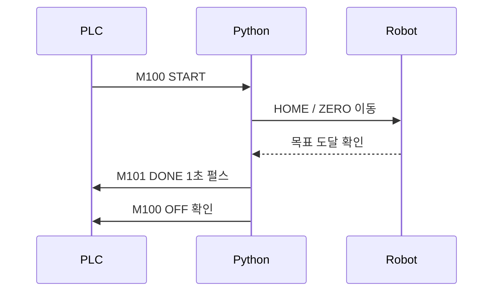

# 신이서 · FA 자동화 포트폴리오
**입력부터 출력까지, 신호와 장치의 동작을 연결합니다.**

PLC · HMI · 인버터 / 서보 · CC-Link · 공압 / 유압 · Python · 산업용 로봇

[GitHub](https://github.com/seo219) · [프로그래밍 포트폴리오](https://github.com/seo219/programming-portfolio)

---

## 소개

PLC 공정 제어와 구동 장치, 공유압 회로, 산업용 로봇, SO-101 팀 프로젝트를 정리했습니다. 교육 실습과 팀 프로젝트를 구분하고, 제어 흐름·실제 역할·문제 해결·검증 조건을 설명합니다.

## 대표 프로젝트 · AI 로봇 윷놀이

**담당 분야: SO-101 로봇암** · 5인 팀 · 2026년 10~11월

모방학습용 동작 데이터 수집과 로봇암 관련 작업을 수행했습니다. 팀은 기간 내 동작 안정화를 위해 측정 자세 기반 Python 제어로 전환했고, 최종 시스템에 손목 카메라 위치 보정·파지 확인·재시도를 적용했습니다.

| 문제 | 팀의 대응 |
|---|---|
| 말이 기준 위치에서 벗어나 빈 파지 | 손목 카메라 보정, 그리퍼 상태 확인 |
| 업힌 말의 높이·이송 간섭 | 칸별 높이 측정, 먼저 수직 상승 |
| 장치와 게임 상태의 불일치 | HOME 복귀 후 판 확인, 실패·재시도 구분 |

**보고된 실물 결과:** 게임 4판에서 이동 86회 중 85회 성공. **재시도 18회 포함**이며 최초 시도 성공률과 구분합니다.

[프로젝트 상세](docs/ai-yutnori-robot-arm.md) · [v7 보고서 대조와 실물 시험](evidence-yutnori.md) · [팀 소스](source-yutnori-team.zip)

## 분야별 제어 경험

| 분야 | 내용 | 상세 |
|---|---|---|
| PLC 공정 | 센서 완료 조건·단계 릴레이 기반 순차 제어 | [PLC 제어](docs/plc-control.md) |
| 구동·통신 | 인버터 아날로그/다단 속도, 서보 JOG·티칭·M-code, CC-Link | [PLC 제어](docs/plc-control.md) |
| PLC ↔ Python ↔ Indy | START 감시 → 이동 완료 → DONE 응답 → 재트리거 방지 | [핸드셰이크](docs/plc-robot-handshake.md) |
| Indy 로봇 | TCP 상대 이동, 5×5 위치 생성, 그리퍼·팔레타이징 | [로봇 제어](docs/robot-control.md) |
| 공압·유압 | 밸브·실린더·모터 배관과 구동 특성 | [공유압](docs/fluid-power.md) |
| SO-101 독립 도구 | 칸별 티칭·경로·파지 확인, 모의 장치 테스트 | [Drive 자동화 자료](drive-automation.md) |
| Arduino | 센서·RGB·PWM·Bluetooth·시리얼 프로토콜 | [Drive 자동화 자료](drive-automation.md) |
| 인터페이스 설계 | Drive 신호 주소 메모, 기존 예제와의 차이 | [I/O 정의](io-map.md) |

## 실제 파일

| 자료 | 다운로드 |
|---|---|
| PLC 래더 PDF 67개 · HMI/제어 PNG 15개 | [82개 실습 자료](source-plc-ladder.zip) |
| 윷놀이 팀 코드·설정·문서 178개 | [소스 ZIP](source-yutnori-team.zip) |
| 독립 로봇 도구·설정·문서 11개 | [소스 ZIP](source-robot-tools.zip) |
| Arduino 스케치 24개 | [소스 ZIP](source-arduino.zip) |

[자료별 설명](drive-automation.md) · [소스 목록](source-manifest.csv) · [반영·제외 기준](coverage.md)

## 설비 연동 예제 흐름

위 주소는 pc_plc_robot.py 실습 기준입니다. Drive의 [I/O 정의 메모](io-map.md)는 M101을 리셋으로 정의하므로 별개 인터페이스로 구분합니다.

## 검증과 범위

실제 하드웨어 없이 팀 로봇 테스트 58개·독립 도구 15개가 통과했습니다. v7 실물 시험 수치는 결과보고서·발표자료에서 확인했으며 이번 정리에서 재측정하지 않았습니다.

교육 실습을 상용 설비 납품이나 현장 시운전 실적으로 표현하지 않습니다. 독립 도구·팀 ZIP·v7 최종 보고서의 버전을 구분하고, 원본 설정·자세 형식이 서로 같다고 가정하지 않습니다.

[기술별 코드 분석](docs/coding-portfolio.md) · [출처](docs/sources.md)
