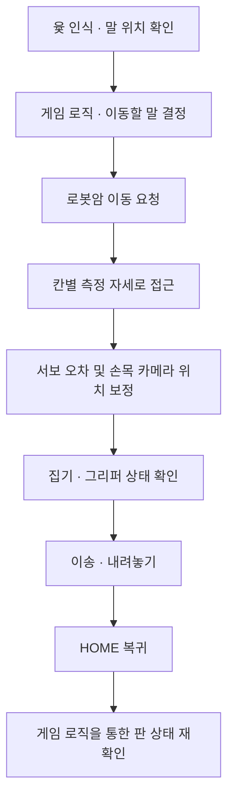

# AI 로봇 윷놀이 · 로봇암 제어

[← 포트폴리오](../README.md)

> 사람이 던진 실제 윷을 인식하고, 게임에서 결정한 말을 SO-101 로봇암으로 옮기는 팀 프로젝트입니다. 개인 담당 분야는 로봇암입니다.

| 항목 | 내용 |
|---|---|
| 기간 | 2026년 10~11월, 발표자료 기준 평일 10일 개발 |
| 팀 | 5명 |
| 담당 분야 | 로봇암 · 모방학습용 동작 데이터 수집, 자세 측정 및 말 이송 관련 작업 |
| 장비·기술 | SO-101, Python, LeRobot, 손목 카메라 |
| 제어 방식 | 칸별 측정 자세를 따라가는 Python 스크립트 |
| 핵심 문제 | 말이 기준 위치에서 벗어나면 좌표만으로는 파지 실패 |
| 개선 방향 | 측정 자세와 손목 카메라 위치 보정, 파지 확인·재시도 결합 |

## 프로젝트 목표와 담당 범위

카메라 인식, 게임 진행, 대결 AI, 중계·화면, 로봇암을 연결해 사람이 실제 말과 윷으로 참여하는 시스템을 만들었습니다. 로봇암은 사람 말과 로봇 말의 이동, 잡힌 말 반환, 업힌 말 이송을 수행합니다.

**개인 담당:** 로봇암 분야입니다. 발표자료 역할 표에는 모방학습용 동작 데이터셋 수집이, 발표자 노트에는 칸별 자세 측정과 말 이송 동작이 기재되어 있습니다.

**팀 로봇 모듈 성과:** 아래 위치 보정, 파지 확인, 통합 시험 결과는 발표자료에 제시된 모듈 전체 결과입니다. 손목 카메라 인식 알고리즘 등 협업 범위를 개인 단독 구현 성과로 표현하지 않았습니다. 비전 모델 학습, 대결 AI, 게임 엔진, 중계·화면은 다른 담당 분야입니다.

## 시스템 안에서의 역할

비전과 로봇은 게임 로직을 통해 연결됩니다. 이동할 말을 고르는 판단과 실제로 말을 집어 옮기는 실행을 분리했습니다. HOME 복귀 후에는 팔이 판을 가리지 않는 상태에서 전체 말 위치를 확인합니다.

## 구현 과정

### 1. 모방학습 검토에서 측정 자세 기반 제어로 전환

초기에는 모방학습을 검토하고 동작 데이터를 수집했습니다. 발표자료에 따르면 하드웨어 문제와 학습 소요 시간으로 인해, 11월 6일 제한된 개발 기간 안에 동작을 안정화하기 위해 Python 스크립트 방식으로 전환했습니다.

최종 방식에서 LeRobot은 모터 제어와 보정에 사용했으며 학습 기능은 사용하지 않았습니다. 따라서 최종 로봇 동작을 학습 모델의 성과로 소개하지 않습니다.

### 2. 칸별 자세와 높이 측정

윷판 29칸과 대기 자리 4곳, 총 33곳의 보정 값을 측정했습니다. 업힌 말은 단일 말과 집는 높이가 달라 칸별 높이도 따로 측정했습니다.

고정된 기준 위치를 마련하고, 접근·집기·이송을 반복 가능한 동작으로 구성하는 것이 기초 작업이었습니다.

### 3. 손목 카메라로 집기 직전 위치 보정

좌표만으로 접근하면 말이 몇 mm 비켜 있는 경우 허공을 집는 문제가 있었습니다. 11월 12일 손목 카메라를 사용해 집기 직전 말 중심의 어긋남을 확인하는 방식으로 보완했습니다.

1. 칸 위로 이동하고 서보 오차를 보정합니다.
2. 손목 카메라로 말 위치를 촬영합니다.
3. 기준 중심과의 차이만큼 위치를 보정합니다.
4. 3 mm 미만 차이는 무시하고, 25 mm를 넘는 차이는 다른 말일 수 있어 보정하지 않습니다.
5. 집은 뒤 그리퍼가 닫힌 정도로 파지 여부를 판단합니다.
6. 헛집은 경우 재촬영 후 한 번 더 집습니다.

### 4. 업힌 말과 이송 경로 보완

업힌 말을 집을 때 아래 말을 건드리는 문제가 있었습니다. 말의 적층 높이를 고려하고, 집은 뒤에는 먼저 수직으로 들어 올리는 동작을 적용했습니다. 내려간 뒤 서보 오차를 한 번 더 보정하는 등 실제 동작에서 드러난 문제를 보완했습니다.

## 문제와 해결

| 관찰한 문제 | 적용한 대응 | 제어 관점 |
|---|---|---|
| 기준 좌표에서 조금 벗어난 말을 놓침 | 손목 카메라로 집기 직전 위치 보정 | 고정 자세에 실제 관측값 결합 |
| 집기 명령은 실행했지만 말을 잡지 못함 | 그리퍼 값으로 파지 판단, 재촬영·재시도 | 명령 수행과 작업 성공을 구분 |
| 업힌 말 이송 중 아래 말을 건드림 | 칸별 높이 측정, 수직 상승 후 이송 | 대상물 높이와 경로를 함께 고려 |
| 로봇 팔이 판을 가림 | HOME 복귀 후 전체 판 확인 | 동작과 검증 순서 조정 |
| 제한된 기간 내 학습 방식 안정화 어려움 | 측정 자세 기반 Python 제어로 전환 | 개발 일정과 재현성을 고려한 방식 선택 |

## 시험 결과

**다음 수치는 v7 발표자료의 팀 시험 기록이며, 이 포트폴리오 정리 과정에서 재측정한 결과가 아닙니다.**

| 시험 | 발표자료에 보고된 결과 | 해석 범위 |
|---|---|---|
| 칸 4쌍 왕복 시험 | 각 10회 모두 성공 | 제한된 칸 조합의 반복 시험 |
| 2026-11-12 실물 게임 4판 | 말 이동 86회 중 85회 성공 | 재시도 18회 포함, 최초 시도 성공률과 구분 |
| 보정 대상 | 판 29칸 + 대기 자리 4곳 = 33곳 | 측정·보정 위치 수 |

발표자료는 실물 게임 수치의 근거로 `data/game_stats.csv`를 명시합니다. 현재 포트폴리오에는 해당 원시 로그가 포함되어 있지 않아 로그 대조는 수행하지 않았습니다. 수치는 해당 환경과 시험 범위에 한정됩니다.

## FA 자동화 직무와의 연결

- **티칭·보정:** 실제 장치의 칸별 자세와 높이를 측정해 반복 작업의 기준을 마련했습니다.
- **시퀀스 구성:** 접근 → 보정 → 집기 → 확인 → 이송 → 복귀 → 판 확인 순서를 연결했습니다.
- **오류 대응:** 파지 실패를 확인하고 재시도하는 흐름으로 작업 완료 여부를 구분했습니다.
- **통합:** 게임 로직의 작업 요청과 로봇의 물리 동작을 연결했습니다.

기존 Indy 로봇·PLC 연동 실습과는 별도의 SO-101 팀 프로젝트입니다. 이 프로젝트에 PLC를 사용했다고 표현하지 않습니다.

## 자료와 공개 범위

근거는 사용자가 제공한 **AI 로봇 윷놀이 발표자료 v7**의 슬라이드 4, 7, 10, 15~18, 20과 발표자 노트입니다. 추가로 v7 HWP 본문과 Drive 코드 스냅샷을 확인했습니다. 원시 실물 게임 로그는 대조하지 않았습니다.

원본 발표 파일과 팀 자료를 통째로 재배포하지 않고 로봇암 관련 내용을 요약했습니다. Drive에서 제공한 팀 코드와 독립 도구는 [자동화 자료](../drive-automation.md)에 공개용 ZIP으로 업로드했습니다. 모의 로봇 테스트 73개가 통과했으며, 최종 v7 전체 소스와는 구분합니다. [보고서 대조](../evidence-yutnori.md)에서 추가 시험 조건을 확인할 수 있습니다.
