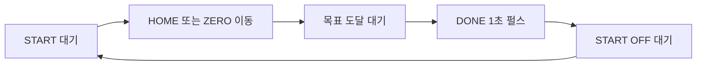

# PLC ↔ Python ↔ Robot 신호 연동

[← 포트폴리오](../README.md)

> PLC의 시작 요청을 로봇 이동 명령으로 연결하고, 목표 도달 후 완료 신호를 반환하는 교육 실습입니다.

## 목적과 구성

PLC와 로봇은 서로 다른 제어 환경을 사용합니다. Python을 중간 제어 프로그램으로 두고 PLC 비트를 읽어 로봇을 움직이며, 완료 상태를 PLC에 다시 전달했습니다.

| 구분 | 구성 |
|---|---|
| PLC 통신 | pymcprotocol Type3E |
| 로봇 제어 | Neuromeka IndyDCP3 |
| 시작 요청 | M100 · PLC → Python |
| 완료 응답 | M101 · Python → PLC |
| 동작 | HOME과 ZERO 위치를 번갈아 이동 |
| 원본 | [pc_plc_robot.py](https://github.com/seo219/neuromeka_Py/blob/main/pc_plc_robot.py) |

## 구현 흐름

1. PLC에 연결하고 M100 비트를 주기적으로 읽습니다.
2. M100이 ON이면 내부 상태에 따라 ZERO 또는 HOME 이동을 실행합니다.
3. `is_target_reached`를 기다린 후 내부 위치 상태를 갱신합니다.
4. M101을 1초간 ON한 뒤 OFF로 되돌립니다.
5. M100이 OFF가 될 때까지 기다려 동일 요청의 반복 실행을 막습니다.
6. 종료 처리에서 DONE 초기화와 PLC 연결 해제를 시도합니다.

## 제어 포인트

**명령 전달과 완료 확인을 구분했습니다.** 이동 명령을 보낸 직후 DONE을 반환하지 않고 목표 도달 상태를 기다립니다.

**한 번의 요청에 한 사이클을 대응시켰습니다.** 시작 신호가 계속 ON인 동안 같은 모션이 반복되지 않도록 OFF 확인 단계를 둡니다.

**신호 방향을 명확히 했습니다.** START는 PLC가 요청하고 DONE은 Python이 반환하는 구조로 역할을 나눕니다.

## 원본에서 확인되는 한계와 개선 방향

| 현재 실습 코드 | 확장할 때 보완할 사항 |
|---|---|
| 시작 시 HOME에 있다고 가정 | 실제 로봇 상태와 내부 상태를 동기화하는 초기화 절차 |
| 1초 DONE 펄스 | PLC 스캔·통신 주기를 고려한 ACK 방식 검토 |
| START OFF를 계속 대기 | 대기 타임아웃과 이상 상태 표시 |
| 예외 발생 시 메시지 출력 후 재시도 | 통신 단절 시 상태 전이, 재접속 정책, 오류 기록 |
| START/DONE 두 비트 사용 | BUSY·ERROR·RESET을 포함한 신호 계약 |

위 보완 항목은 개선 제안이며 현재 구현 완료 사항이 아닙니다. 이 연동은 일반 제어 신호 실습으로, 안전 회로의 기능을 대신하지 않습니다.
